# Отчёт по лабораторной работе
## «Геометрия суперпозиции и Sparse Autoencoders в Transformer-моделях»

Этот отчёт объясняет **всё**, что сделано в `lab1.ipynb`: зачем каждое задание, что именно мы делали, что получилось
и почему. Сложные места сопровождаются аналогиями из обычной жизни. Формулы тоже есть, но рядом с каждой
написано словами, что она значит. Если формула непонятна, её можно пропустить и читать только текст вокруг.

---

## Содержание

0. [Как устроены файлы и как запустить](#0-как-устроены-файлы-и-как-запустить)
1. [Минимум понятий, без которых дальше не обойтись](#1-минимум-понятий-без-которых-дальше-не-обойтись)
2. [Задание 1. Концентрация меры и «паразитный конус»](#2-задание-1-концентрация-меры-и-паразитный-конус)
3. [Задание 2. Суперпозиция: как упаковать 40 признаков в 10 измерений](#3-задание-2-суперпозиция-как-упаковать-40-признаков-в-10-измерений)
4. [Задание 3. Sparse Autoencoder: поломка и починка](#4-задание-3-sparse-autoencoder-поломка-и-починка)
5. [Задание 4. Steering: рулим моделью через нейрон и через признак](#5-задание-4-steering-рулим-моделью-через-нейрон-и-через-признак)
6. [Где результаты разошлись с методичкой (важно для защиты)](#6-где-результаты-разошлись-с-методичкой-важно-для-защиты)
7. [Вероятные вопросы на защите и короткие ответы](#7-вероятные-вопросы-на-защите-и-короткие-ответы)
8. [Словарик терминов](#8-словарик-терминов)

---

## 0. Как устроены файлы и как запустить

| Файл / папка | Что это |
|---|---|
| `lab1.pdf` | Задание от преподавателя |
| `lab1.ipynb` | Ноутбук со всем решением: код, графики, выводы |
| `lab1_отчет.md` | Этот отчёт |
| `report_img/` | Графики из ноутбука, которые вставлены в отчёт |
| `sae_pythia70m_layer3.pt` | Обученный автоэнкодер из задания 3 (нужен заданию 4) |
| `requirements.txt` | Список библиотек и их версий |
| `.venv/` | Отдельное «окружение» Python со всеми библиотеками |

**Зачем отдельное окружение `.venv`.** Представьте, что для каждой лабораторной у вас свой ящик с инструментами.
Если одной лабе нужна отвёртка версии 2, а другой версии 3, они не мешают друг другу. `.venv` — такой ящик
для этой лабы: в нём лежат `numpy`, `torch`, `transformers` и остальное нужных версий.

**Как запустить.** Откройте `lab1.ipynb` в VS Code, справа сверху выберите ядро **«Python (lab1 МО)»**
и нажмите **Run All**. Весь ноутбук считается примерно 12 минут: модель скачивается один раз, дальше берётся из кэша.

**Используемые библиотеки простыми словами:**
- `numpy` — калькулятор для больших таблиц чисел;
- `scipy` — статистика (нормальное распределение, эксцесс) и кластеризация;
- `pandas` — красивые таблицы;
- `matplotlib` — графики;
- `torch` (PyTorch) — нейросети и их обучение;
- `transformers` — готовые языковые модели, у нас это Pythia-70m;
- `datasets` — готовые наборы текстов, у нас это кусок корпуса The Pile.

---

## 1. Минимум понятий, без которых дальше не обойтись

### 1.1 Вектор, размерность, норма

**Вектор** — это просто список чисел, например `[0.3, -1.2, 0.8]`. Его удобно представлять как **стрелку**:
в 2D это стрелка на листе бумаги (2 числа: вправо и вверх), в 3D — стрелка в комнате (3 числа).

**Размерность $d$** — сколько чисел в списке. В лабе встречаются векторы размерности 10, 512 и даже 4096.
Представить 512-мерное пространство нельзя, но все правила работают так же, как на плоскости.

**Норма** $\|x\|$ — длина стрелки. Считается по теореме Пифагора: $\|x\| = \sqrt{x_1^2 + x_2^2 + \dots + x_d^2}$.

**Нормировка** — поделить вектор на его длину, чтобы длина стала 1. Направление остаётся тем же.
Все такие стрелки длины 1 касаются концами **единичной сферы**, которую в формулах пишут как $\mathbb{S}^{d-1}$.

### 1.2 Скалярное произведение и косинус

**Скалярное произведение** двух векторов: $\langle u, v\rangle = u_1 v_1 + u_2 v_2 + \dots + u_d v_d$.

Если оба вектора длины 1, то скалярное произведение равно **косинусу угла** между ними:
- $\cos = 1$: стрелки смотрят в одну сторону;
- $\cos = 0$: стрелки перпендикулярны (**ортогональны**), то есть «ничего общего»;
- $\cos = -1$: смотрят в противоположные стороны (**антиподы**).

> **Аналогия.** Косинус — это «насколько два человека идут в одну сторону». Если оба идут на север,
> косинус 1. Один на север, другой на восток — 0. Один на север, другой на юг — −1.

### 1.3 Распределение, среднее, дисперсия, эксцесс

Когда мы много раз что-то измеряем (например, 20 000 косинусов), получаем **распределение**: какие значения
встречаются часто, а какие редко. Его рисуют **гистограммой**: столбики показывают, сколько значений попало в каждый интервал.

- **Среднее $\mu$** — «центр» распределения.
- **Дисперсия $\sigma^2$** — насколько значения разбросаны вокруг центра. $\sigma$ (корень из дисперсии) — «типичное отклонение».
- **Нормальное распределение $\mathcal{N}(\mu, \sigma^2)$** — знаменитый «колокол». Так распределены рост людей,
  ошибки измерений и многое другое. Запись $\mathcal{N}(0, 1/d)$ значит: колокол с центром в 0 и дисперсией $1/d$.
- **Эксцесс (kurtosis)** — насколько у распределения «тяжёлые хвосты», то есть как часто встречаются значения далеко от центра.
  У нормального колокола эксцесс равен 0 (мы используем «избыточный» эксцесс, где 0 — это норма).
  Больше 0: редкие, но сильные выбросы случаются чаще, чем у колокола. Меньше 0: хвосты «обрезаны», распределение
  более «плоское».

### 1.4 Языковая модель, токены, эмбеддинги

**Языковая модель** (LLM) читает текст и предсказывает следующее слово. У нас это **Pythia-70m** — маленькая
(70 млн параметров) открытая модель от EleutherAI.

**Токен** — кусочек текста, с которым работает модель: слово, часть слова или знак препинания.
У Pythia в словаре 50 277 токенов.

**Эмбеддинг** — вектор, которым модель представляет токен. Каждому токену соответствует вектор из 512 чисел.
Вся таблица эмбеддингов — это матрица $50\,277 \times 512$.

> **Аналогия.** Эмбеддинг — это «координаты слова на карте смыслов». Похожие слова («кошка», «котёнок») стоят
> близко, непохожие — далеко. Только карта не двумерная, а 512-мерная.

### 1.5 Трансформер и residual stream

Pythia — **трансформер**. Внутри у неё 6 **слоёв** (блоков), идущих друг за другом. Для каждого токена есть
вектор из 512 чисел, который проходит через все слои, и каждый слой **добавляет** к нему свою поправку.

Этот «текущий вектор токена» называется **residual stream** (остаточный поток).

> **Аналогия.** Residual stream — это **общая тетрадь**, которую передают по цепочке 6 экспертов. Каждый
> читает, что написано, и **дописывает** своё, не стирая чужого. После последнего эксперта по записям в тетради
> предсказывается следующее слово.

В заданиях 3 и 4 мы «подглядываем» в эту тетрадь после 3-го эксперта (слоя).

### 1.6 Обучение нейросети: loss, градиент, Adam

- **Loss (функция потерь)** — число, которое показывает, насколько модель ошибается. Цель обучения — сделать его маленьким.
- **MSE** (среднеквадратичная ошибка) — средний квадрат разницы между «правильным» и «полученным».
- **Cross-Entropy (CE)** — loss для предсказания слов. Чем увереннее модель в правильном слове, тем меньше CE.
- **Градиент** — «куда и насколько подвинуть каждый параметр, чтобы loss уменьшился».
- **Градиентный спуск** — многократно делаем маленький шаг против градиента.
- **Adam** — «умный» вариант градиентного спуска, который сам подбирает размер шага для каждого параметра.
- **Learning rate (lr)** — базовый размер шага. Слишком большой — «перепрыгиваем» минимум, слишком маленький — учимся годами.

> **Аналогия.** Обучение — это спуск с горы в тумане. Loss — высота, где вы стоите. Градиент показывает,
> в какую сторону склон идёт вниз. Learning rate — длина шага.

### 1.7 ReLU

$\mathrm{ReLU}(z) = \max(0, z)$: положительные числа пропускаются как есть, отрицательные превращаются в 0.

> **Аналогия.** ReLU — это **турникет**, который пропускает только «вперёд». Всё, что пытается пройти «назад»
> (отрицательное), останавливается и превращается в ноль.

---

## 2. Задание 1. Концентрация меры и «паразитный конус»

### Зачем это задание

Понять две вещи:
1. Как ведут себя **случайные** векторы в многомерном пространстве. Это «эталон», с которым потом сравниваются настоящие данные.
2. Почему **настоящие** эмбеддинги языковых моделей ведут себя совсем не как случайные и как это исправить.

---

### 2.1 Синтетический тест: концентрация меры

#### Что делали

1. Сгенерировали 20 000 пар случайных векторов размерности $d$. Каждое число взято из нормального распределения $\mathcal{N}(0,1)$.
2. Нормировали каждый вектор на длину 1, то есть «положили на сферу».
3. Для каждой пары посчитали косинус $s_i = \langle u_i, v_i \rangle$.
4. Повторили для $d = 16, 64, 256, 512, 4096$.
5. Нарисовали гистограммы и поверх каждой — теоретический колокол $\mathcal{N}(0, 1/d)$.

**Как это сделано в коде без циклов («векторизованно»).** Вместо того чтобы 20 000 раз считать косинус в цикле,
мы кладём все векторы в две большие таблицы $X$ и $Y$ ($20\,000 \times d$) и делаем всё одной операцией над таблицами:
`np.sum(U * V, axis=1)` — перемножить поэлементно и сложить в каждой строке. Это в десятки раз быстрее.

#### Что получилось

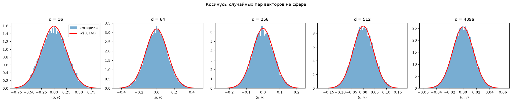

| $d$ | $\sigma^2$ теория $= 1/d$ | $\hat\sigma^2$ выборочная | $\hat\mu$ | эксцесс выборочный | эксцесс теория $= -6/(d+2)$ |
|---|---|---|---|---|---|
| 16 | 0.0625 | 0.0632 | 0.001 | −0.31 | −0.33 |
| 64 | 0.0156 | 0.0155 | −0.001 | −0.07 | −0.09 |
| 256 | 0.0039 | 0.0039 | 0.000 | −0.06 | −0.02 |
| 512 | 0.00195 | 0.00198 | 0.000 | −0.02 | −0.01 |
| 4096 | 0.000244 | 0.000244 | 0.000 | 0.01 | −0.001 |

#### Как это понимать

**1. Среднее $\approx 0$.** В среднем два случайных вектора перпендикулярны.

**2. Разброс сужается с ростом $d$.** Типичный косинус $\approx \pm 1/\sqrt{d}$:
- при $d = 16$: $\pm 0.25$ — векторы бывают довольно похожи;
- при $d = 4096$: $\pm 0.016$ — векторы **почти всегда** почти перпендикулярны.

Это и называется **концентрацией меры**: в многомерном пространстве почти вся «масса» случайных направлений
сосредоточена возле «экватора» относительно любого выбранного направления.

> **Аналогия.** На плоскости есть всего 2 независимых направления (север–юг и запад–восток), и два случайных
> человека легко идут «примерно в одну сторону». А теперь представьте город, где **4096 независимых направлений**.
> Шанс, что два случайных прохожих идут хоть сколько-нибудь в одну сторону, ничтожен: у каждого «своя» улица.
> Поэтому в многомерии **всё почти перпендикулярно всему**.

**Почему дисперсия именно $1/d$.** Косинус — это сумма $d$ слагаемых $u_1 v_1 + \dots + u_d v_d$. Каждое
слагаемое маленькое (порядка $1/d$ по дисперсии), знаки у них случайные, и они в основном гасят друг друга.
Итоговая дисперсия получается $d \cdot (1/d^2) = 1/d$. А сумма многих независимых маленьких слагаемых по
**центральной предельной теореме** (ЦПТ) даёт колокол.

**3. Эксцесс.** При малых $d$ он отрицательный: распределение «площе» колокола. Причина простая: косинус **не может**
выйти за пределы $[-1, 1]$, поэтому хвосты обрезаны. Я добавил в таблицу **точную** формулу эксцесса $-6/(d+2)$.
Выборочные значения с ней согласуются: при $d=16$ получилось −0.31, теория даёт −0.33. С ростом $d$ эксцесс
стремится к 0, и распределение становится настоящим колоколом.

> **Коротко:** теория полностью подтвердилась. Случайные векторы в многомерии почти перпендикулярны, разброс
> косинусов $\sigma = 1/\sqrt d$.

---

### 2.2 Эмбеддинги Pythia-70m: «паразитный конус»

#### Что делали

1. Загрузили модель Pythia-70m и взяли матрицу входных эмбеддингов `embed_in` ($50\,304 \times 512$).
2. **Обрезали** её до 50 277 строк. Матрица специально дополнена до числа, кратного 64: видеокарты быстрее
   считают таблицы «круглых» размеров. Лишние строки не соответствуют никаким токенам, их нужно выкинуть.
3. Нормировали все строки на длину 1.
4. Взяли 10 000 случайных пар токенов, посчитали косинусы и сравнили с теоретическим $\mathcal{N}(0, 1/512)$.

#### Первый сюрприз: у `embed_in` конуса почти нет

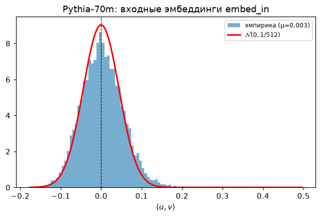

| | $\mu$ | $\sigma^2 / \sigma^2_{теор}$ | эксцесс |
|---|---|---|---|
| `embed_in` (сырые) | 0.003 | 1.42 | 2.0 |

Методичка обещала сдвиг среднего $\mu \in [0.15, 0.35]$, а у нас $\mu \approx 0.003$. Анизотропия (неодинаковость
по направлениям) у `embed_in` всё же есть, но слабая: разброс в 1.4 раза больше теоретического, и хвосты тяжелее
(эксцесс 2).

**Почему так.** У Pythia **две разные** таблицы эмбеддингов:
- `embed_in` — «входной словарь»: превращает прочитанное слово в вектор;
- `embed_out` — «выходной словарь»: по вектору в конце решает, какое слово сказать.

Код это подтверждает: `tie_word_embeddings = False`, то есть таблицы **не связаны**. Классический «паразитный конус»
образуется в **выходной** таблице, потому что именно она стоит перед softmax (механизм выбора следующего слова).
Поэтому я проверил и её.

#### У `embed_out` конус огромный

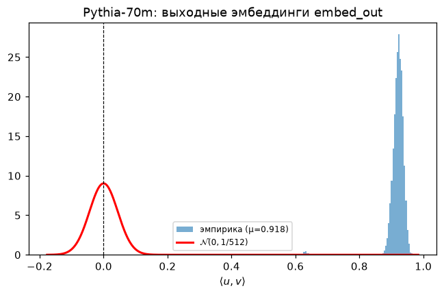

| | $\mu$ | $\sigma^2 / \sigma^2_{теор}$ | эксцесс |
|---|---|---|---|
| `embed_out` (сырые) | **0.918** | 0.59 | 60 |

Средний косинус между **случайными** словами равен 0.92! Почти все 50 тысяч векторов смотрят практически
в одну сторону. Они сидят в узком **конусе**.

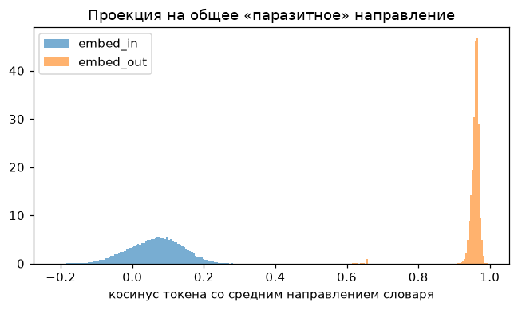

На этом графике видно, что у `embed_out` почти каждый токен имеет большой косинус с «общим» направлением словаря,
а у `embed_in` распределение около нуля.

> **Аналогия.** Представьте 50 000 флюгеров, которые должны показывать в самые разные стороны (у каждого слова
> «свой смысл»). Но дует сильный ветер, и все флюгеры развернулись почти в одну сторону. Разница между ними
> осталась, но она маленькая на фоне общего наклона. Сравнивать слова по «углу между флюгерами» становится
> бессмысленно: все углы маленькие.

#### Почему возникает паразитный конус (объяснение для отчёта)

**Математика (очень просто).** На каждом шаге обучения модель видит контекст $h$ (вектор) и должна предсказать
правильное слово $y$. Формула градиента для вектора слова $w_k$:

$$
\frac{\partial \mathcal{L}}{\partial w_k} = (p_k - \mathbb{1}[k = y])\, h
$$

Словами:
- **правильное** слово $y$ тянут **к** контексту $h$;
- **все остальные** слова $k$ толкают **от** контекста $h$, с силой, пропорциональной $p_k$ (вероятности, которую модель им ошибочно дала).

Словарь огромный (50 тысяч слов), а правильное слово в каждый момент одно. Значит, почти каждое слово почти
всегда оказывается «неправильным» и получает толчок **против** $h$. Контексты $h$ в среднем тоже смотрят в
некоторую общую сторону. В сумме все редкие слова миллионы раз толкают **в одну и ту же сторону** — против среднего
контекста. У каждого вектора накапливается одинаковая добавка $\bar w$:

$$
w_k = \bar w + \tilde w_k,
$$

где $\bar w$ — общая часть (одна на всех), а $\tilde w_k$ — индивидуальная. Если общая часть длиннее
индивидуальной, все косинусы большие. Это и есть конус.

> **Аналогия со снегом.** Ветер всю зиму дует с одной стороны. Каждый сугроб в городе растёт со своей формой,
> но у всех одинаковый наклон по ветру. «Ветер» здесь — это систематический толчок «неправильных» слов в одну сторону.

**Физика (зачем модели это «выгодно»).** У выходного слоя Pythia нет **смещения** (bias). Смещение — это
отдельное число для каждого слова, которое говорит «это слово в целом частое, предсказывай его почаще».
Модели всё равно нужно знать частоту слов. Она «прячет» это знание в общее направление: если у всех контекстов
$h$ есть постоянная часть $c$, то $\langle h, w_k \rangle$ содержит слагаемое $\langle c, w_k \rangle$, которое
работает как смещение слова. Общее направление превращается в **«ось частотности»**.

**Почему у `embed_in` конуса нет.** Входной вектор слова меняется, только когда слово **встречается** в тексте,
и направление изменения зависит от контекста. Систематического толчка «всех в одну сторону» нет.

#### Как исправить: центрирование и whitening

Совет ИИ и литературы (методы *All-but-the-top*, *whitening для BERT*):

**Шаг 1. Центрирование.** Вычесть из каждого вектора средний вектор словаря: $\tilde W = W - \bar w$.

> **Аналогия.** Все флюгеры наклонены ветром. Мы измеряем средний наклон и «вычитаем ветер». Остаётся
> только индивидуальная часть каждого флюгера.

**Шаг 2. Whitening (отбеливание).** Даже после центрирования облако точек может быть **сплюснутым**: в одних
направлениях вытянуто, в других сжато. Whitening растягивает и сжимает облако так, чтобы во всех направлениях
разброс стал одинаковым, то есть превращает «дыню» в «шар».

Формула: $\hat W = \tilde W \, C^{-1/2}$, где $C$ — **ковариационная матрица** (таблица 512×512, которая описывает
форму облака). $C^{-1/2}$ — преобразование, «обратное» к сплющиванию.

> **Аналогия.** Фотографию растянули по ширине, и все лица стали широкими. Whitening — это вернуть
> исходные пропорции, чтобы круг снова стал кругом.

**Почему «whitening» (отбеливание).** Термин из обработки сигналов: «белый шум» одинаково силён на всех частотах.
После whitening данные тоже «одинаково сильны» во всех направлениях.

#### Результат исправления

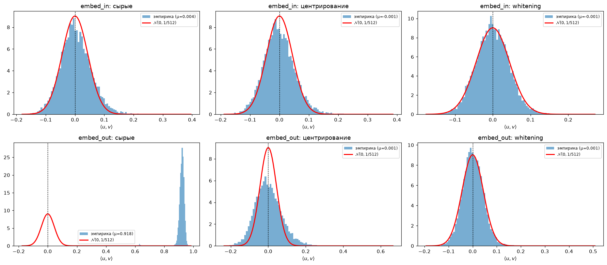

| | $\mu$ | $\sigma^2 / \sigma^2_{теор}$ | эксцесс |
|---|---|---|---|
| embed_in: сырые | 0.004 | 1.45 | 1.4 |
| embed_in: центрирование | −0.001 | 1.44 | 1.5 |
| embed_in: **whitening** | −0.001 | **0.97** | 0.4 |
| embed_out: сырые | **0.918** | 0.64 | 57 |
| embed_out: центрирование | 0.001 | 2.72 | 2.2 |
| embed_out: **whitening** | 0.001 | **0.98** | 3.6 |

(Числа чуть отличаются от предыдущей таблицы, потому что для честного сравнения здесь взят другой, общий для
всех вариантов набор пар.)

**Что видно:**
- центрирование убирает сдвиг: $\mu \to 0$. Но колокол остаётся слишком широким (у `embed_out` дисперсия даже в
  2.7 раза больше нормы), потому что облако сплюснуто;
- whitening выравнивает форму: дисперсия становится $\approx 1/512$ (отношение 0.97–0.98), и гистограмма ложится
  на теоретическую кривую. **Совпадение с теорией достигнуто;**
- эксцесс после whitening не ноль (0.4 и 3.6). Whitening выравнивает только «разброс» (второй момент), а редкие
  «странные» токены (служебные, мусорные, почти не встречавшиеся в обучении) всё равно дают тяжёлые хвосты.

> **Практический вывод.** Косинус между «сырыми» эмбеддингами языковой модели завышен общим направлением.
> Прежде чем сравнивать слова по косинусу, векторы надо центрировать, а лучше — отбелить.

---

## 3. Задание 2. Суперпозиция: как упаковать 40 признаков в 10 измерений

### Зачем это задание

Нейросети умеют хранить **больше понятий, чем у них есть измерений**. Это называется **суперпозицией**.
Задание 2 — «игрушечная» модель, на которой это явление видно и можно измерить. Понимание суперпозиции нужно для
заданий 3 и 4: именно из-за неё отдельные нейроны часто «ни о чём», и нужен SAE, чтобы достать понятия обратно.

### 3.1 Модель

- **Признаки** $f \in \mathbb{R}^{40}$: 40 чисел, каждое означает «насколько присутствует понятие $i$».
  Каждый признак **редко** активен: с вероятностью $p$ он принимает случайное значение от 0 до 1, иначе равен 0.
  Формально $f_i = r_i b_i$, где $b_i$ — «монетка» (1 с вероятностью $p$), $r_i$ — случайное число из $[0, 1]$.
- **Сжатие:** $x = W f$, где $W$ — матрица $10 \times 40$. То есть 40 чисел превращаются в 10.
  Каждый столбец $w_i$ — это «направление», которым признак $i$ записывается в 10-мерное пространство.
- **Восстановление:** $\hat f = \mathrm{ReLU}(W^T W f - b)$. Пытаемся из 10 чисел вернуть 40.

**Уровень разреженности** $S = 1 - p$: при $p = 0.01$ каждый признак активен в 1 % случаев, то есть в среднем
активны 0.4 признака из 40.

> **Аналогия: общий шкаф в общежитии.** 40 студентов (признаков), а шкаф на 10 полок (измерений). Если каждый
> студент пользуется шкафом редко, можно «наложить» вещи: у каждого своя комбинация полок. Когда в шкафу вещи
> только одного-двух студентов, легко понять, чьи они. Если все придут одновременно, будет каша.
> Это и есть суперпозиция: выгодна, когда признаки **редко** активны вместе.

### 3.2 Почему появляется интерференционный шум

Разложим восстановление одного признака $i$:

$$
\hat f_i = \mathrm{ReLU}\Big(f_i + \sum_{j \ne i} (w_i^T w_j) f_j - b\Big)
$$

Словами: восстановленное значение = **сам признак** + **эхо от других активных признаков** − порог.
Эхо от признака $j$ тем сильнее, чем больше косинус $w_i^T w_j$, то есть чем больше их направления «похожи».
40 направлений в 10-мерном пространстве не могут быть все перпендикулярны (перпендикулярных направлений
максимум 10), поэтому эхо неизбежно.

> **Аналогия: разговор в соседних комнатах.** Вы слушаете своего собеседника ($f_i$), но через тонкие стены
> слышно соседей ($\sum$). Чем тоньше стена между вами и конкретным соседом (чем больше косинус), тем громче его
> слышно. Порог $b$ — это беруши: они глушат тихие звуки, но заодно и тихие слова собеседника.

### 3.3 Задача 2.1: случайная схема

Сгенерировали случайную $W$ (числа из $\mathcal{N}(0,1)$, каждый столбец нормирован на длину 1) и тестовые
наборы по 20 000 примеров для 18 значений $p$ от 0.01 до 0.5. Сетка $p$ **логарифмическая** (точки гуще при
маленьких $p$), потому что при малых $p$ всё меняется быстрее.

Проверка генератора: средняя «энергия» входа $\mathbb{E}\|f\|^2$ совпала с теорией $Mp/3$
(например, при $p=0.5$: 6.69 против 6.67). Откуда $Mp/3$: каждый из $M = 40$ признаков активен с вероятностью $p$,
а средний квадрат равномерного числа из $[0,1]$ равен $1/3$.

### 3.4 Задача 2.2: зачем нужен порог $b$

#### Почему при $b = 0$ всё плохо даже при $p = 0.01$

Возьмём самый простой случай: активен **один** признак $j$ со значением $r$. Тогда для любого **неактивного**
признака $i$ модель выдаёт $\hat f_i = \mathrm{ReLU}(G_{ij} r)$, где $G_{ij} = w_i^T w_j$.

- Косинусы случайных векторов в 10D имеют разброс $1/\sqrt{10} \approx 0.32$ (вспомните задание 1!), то есть они **немаленькие**.
- Примерно у половины из 39 «соседей» косинус положительный. ReLU их **пропускает**: у ~20 признаков, которых
  на самом деле нет, появляются «ложные срабатывания».

Оценка ошибки: сигнал весит $r^2$, а ложные срабатывания весят $\approx r^2 \cdot 39 \cdot \mathbb{E}[\mathrm{ReLU}(g)^2]
= r^2 \cdot 39 \cdot \frac{1}{2}\cdot\frac{1}{10} \approx 1.95\, r^2$.

$$
\mathrm{NMSE}_{b=0} \approx \frac{M - 1}{2d} = 1.95
$$

Проверили в ноутбуке: формула для нашей конкретной $W$ даёт 1.75, эксперимент — **1.73**. Совпадение отличное.

**Что это значит.** NMSE > 1 — модель **хуже, чем если бы просто всегда отвечала нулями**. И это не зависит от $p$:
при большей разреженности и сигнал, и шум уменьшаются одинаково.

> **Аналогия.** Вас спрашивают «кто сейчас в шкафу?». Без порога вы на каждое слабое эхо отвечаете «этот тоже
> здесь!» и называете 20 лишних студентов вместо одного настоящего. Лучше бы вообще промолчали.

#### Поиск оптимального порога $b^*(p)$

Для каждого $p$ перебрали 201 значение порога от 0 до 1 (**grid search** — поиск по сетке) и выбрали лучший.
Оптимизация кода: произведение $F \cdot W^T W$ от порога не зависит, поэтому оно считается **один раз**, а потом
для каждого $b$ только вычитается порог.

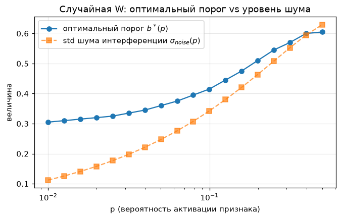

| $p$ | 0.01 | 0.05 | 0.1 | 0.2 | 0.5 |
|---|---|---|---|---|---|
| $b^*$ | 0.305 | 0.360 | 0.415 | 0.510 | 0.605 |
| NMSE при $b^*$ | 0.36 | 0.51 | 0.62 | 0.72 | 0.79 |
| NMSE при $b = 0$ | 1.73 | 1.69 | 1.64 | 1.54 | 1.25 |

**Как меняется $b^*$ и почему.**
- $b^*$ растёт с $p$: чем больше признаков активны одновременно (в среднем $40p$), тем громче суммарное эхо.
  Его «громкость» (стандартное отклонение, пунктир на графике) растёт как $\sqrt p$. Порог тянется за уровнем шума:
  беруши должны быть плотнее в шумной комнате;
- даже при $p \to 0$ порог не падает до нуля: эхо от **одного** соседа бывает до ~0.8, и порог ~0.3 отсекает
  большую часть таких «эхо»;
- при больших $p$ рост $b^*$ замедляется: порог режет и шум, и **настоящий** сигнал (всё, что меньше $b$,
  обнуляется). Слишком плотные беруши — и собеседника не слышно.

### 3.5 Задача 2.3: нормированная ошибка и «коллапс»

#### Ловушка метрики

Если построить обычную ошибку MSE, она просто растёт вместе с $p$. Причина: при большем $p$ на входе больше
«материала», и ошибаться есть в чём. Это ничего не говорит о качестве модели.

> **Аналогия.** Сравнивать двух переводчиков по **числу** ошибок нечестно, если один перевёл страницу, а другой
> книгу. Нужно считать **долю** ошибок.

Поэтому считаем **нормированную** ошибку:

$$
\mathrm{NMSE} = \frac{\mathbb{E}\|f - \hat f\|^2}{\mathbb{E}\|f\|^2}
$$

Числитель — сколько ошиблись, знаменатель — сколько всего было сигнала. Модель, которая всегда отвечает нулями,
имеет NMSE = 1: она «потеряла весь сигнал». Это **тривиальный baseline** (минимальная планка): хорошая модель
должна иметь NMSE < 1.

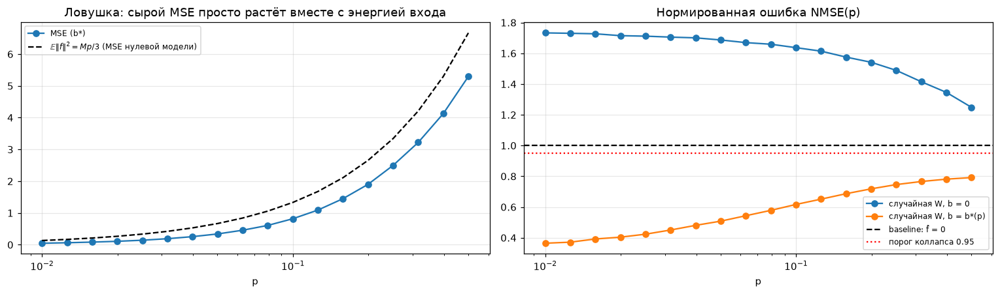

Слева видна ловушка: сырой MSE просто растёт вместе с энергией входа. Справа — честная картина.

#### Точка коллапса $p^*$ (где NMSE ≥ 0.95)

- **При $b = 0$:** модель хуже нуля (NMSE > 1) **уже при $p = 0.01$**, то есть «сколлапсировала» с самого начала: $p^* \le 0.01$.
- **При оптимальном $b^*$:** NMSE растёт с 0.36 до 0.79, но **до 0.95 не доходит**. Я проверил и более плотные
  данные ($p$ до 1.0): NMSE там 0.77–0.79. Значит, в этой постановке точки коллапса с оптимальным порогом **нет**.

**Почему нет коллапса.** Порог подбирается под каждое $p$ отдельно. Он может «пожертвовать» частью признаков
и вырезать шум, так что модель деградирует **плавно**, а не проваливается. К тому же сигнал $f_i$ всегда входит
в свой выход с коэффициентом 1, а эхо складывается из слагаемых со случайными знаками и частично гасится.

Качественный вывод при этом тот же, что и в методичке: случайная упаковка **плохая**. Даже при 1 % активности
теряется больше трети сигнала, а при $p \sim 0.1$ восстанавливается меньше 40 %.

### 3.6 Задача 2.4: обученная модель — настоящая суперпозиция

#### Что делали

Вместо случайной $W$ **обучили** $W$ и вектор порогов $b$ (свой порог для каждого признака) под каждое $p$:
- оптимизатор Adam, 3000 шагов (5000 для графиков геометрии), батч 1024;
- на каждом шаге **свежие** случайные данные, так что переобучиться невозможно: данные бесконечны;
- после каждого шага столбцы $W$ **проецируются** на шар $\|w_i\| \le 1$: если длина столбца больше 1, её
  урезаем до 1. Без этого модель могла бы «схитрить», просто раздувая векторы;
- скорость обучения плавно уменьшается к концу (**cosine schedule**), чтобы в конце делать точные мелкие шаги.

#### Результат: обученная модель в разы лучше

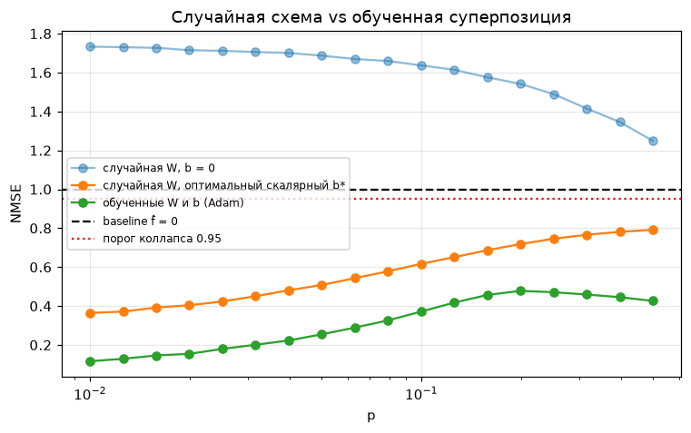

| $p$ | NMSE случайная ($b^*$) | NMSE обученная | живых признаков | измерений на признак |
|---|---|---|---|---|
| 0.01 | 0.36 | **0.11** | 40 из 40 | 0.25 |
| 0.05 | 0.51 | **0.25** | 40 | 0.25 |
| 0.1 | 0.62 | **0.38** | 40 | 0.25 |
| 0.2 | 0.72 | **0.48** | 32 | 0.34 |

- При $p = 0.01$ ошибка упала с 0.36 до 0.11: в 3 раза лучше, на той же размерности!
- Модель хранит **все 40 признаков** в 10 измерениях: 0.25 измерения на признак = $10/40$. Это и есть
  **настоящая суперпозиция**.
- «Измерений на признак» считается как $d / \|W\|_F^2$, где $\|W\|_F^2$ — сумма квадратов длин всех столбцов.
  Если все 40 столбцов длины 1, получается $10/40 = 0.25$. Если часть признаков «выключена» (длина 0),
  число растёт.
- Кривая обученной модели **немонотонна**: максимум ошибки около $p \approx 0.2$, дальше она снова падает. В очень плотном
  режиме модель перестраивается: хранит меньше признаков, но почти без помех.

#### Геометрия: матрица Грама

**Матрица Грама** $G = W^T W$ — таблица 40×40, где на пересечении строки $i$ и столбца $j$ стоит косинус между
направлениями признаков $i$ и $j$. На диагонали — единицы (каждый признак сам с собой).

> **Аналогия.** Это «таблица дружбы» 40 студентов: красное — похожи (мешают друг другу), синее — противоположны,
> белое — независимы.

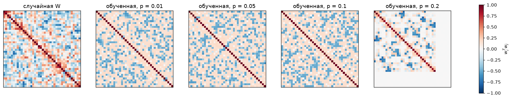

Признаки на картинке переупорядочены так, чтобы похожие стояли рядом (**иерархическая кластеризация**),
а «мёртвые» признаки (длина < 0.5) отправлены в конец.

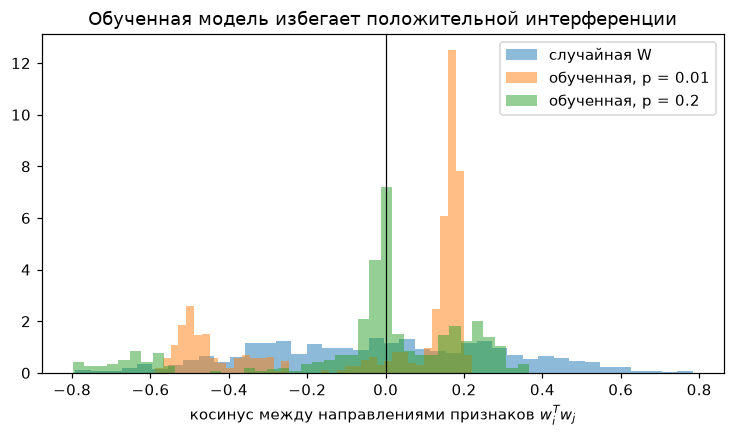

**Главное открытие: обученная модель избегает положительных косинусов.**
- у случайной $W$ косинусы симметричны вокруг нуля и доходят до ±0.8;
- у обученной (при малых $p$) все положительные косинусы ≤ 0.22, зато много пар с косинусом около **−0.5**;
- средний косинус ≈ −0.026 ≈ $-1/(M-1)$: векторы «уравновешены», их сумма почти ноль.

**Почему так выгодно.** Вспомните ReLU-турникет: **отрицательное эхо ReLU срезает бесплатно** (превращает в 0),
а положительное проходит и даёт ложное срабатывание. Поэтому модель расставляет признаки так, чтобы соседи
смотрели **друг от друга**.

> **Аналогия.** Соседей по общежитию расселяют так, чтобы шум от соседа шёл «в минус», в звукопоглощающую
> стену, а не в вашу комнату.

**Ответ на вопрос методички об антиподальных парах** ($w_i \approx -w_j$): при $M = 40$, $d = 10$ их почти нет
(ни одной пары с косинусом < −0.8 при $p \le 0.1$). Антиподальная пара экономит место только для **двух** признаков,
а здесь нужно уместить по **четыре** на измерение. Выгоднее многогранник, где у каждого вектора несколько умеренно
отрицательных соседей. Ортогональных блоков (подпространств) при малых $p$ тоже нет: все 40 векторов делят всё пространство.

**Фазовый переход при росте $p$.** При $p = 0.2$ признаки часто активны вместе, и эхо становится дорогим.
Модель «выключает» 8 признаков (их длина → 0, серые полосы на картинке), остальные становятся ближе к
перпендикулярным, и появляются первые **почти** антиподальные пары (минимальный косинус −0.79). Это переход
от «храню всё, но с помехами» к «храню меньше, но чище». Та же картина описана в статье
*Toy Models of Superposition* (Elhage et al., Anthropic, 2022).

> **Коротко о задании 2.** Случайная упаковка плохая. Обученная использует свойство ReLU и прячет помехи
> в отрицательную область, поэтому 40 редких признаков помещаются в 10 измерений с маленькой ошибкой.

---

## 4. Задание 3. Sparse Autoencoder: поломка и починка

### Зачем это задание

Из задания 2 мы знаем, что модели хранят понятия в суперпозиции, «намешанными» в одних и тех же измерениях.
Если посмотреть на отдельный нейрон (одно число из 512), он обычно реагирует на смесь несвязанных вещей.
**Sparse Autoencoder (SAE)** — инструмент, который «размешивает» эту смесь обратно на отдельные понятия.

### 4.1 Что такое SAE

SAE берёт вектор $x$ из residual stream (512 чисел) и:
1. **Кодирует** его в 2048 чисел (**латенты**). По правилу Top-K ненулевыми остаются только $K = 32$ самых больших,
   остальные зануляются. Это «разреженный» (sparse) код;
2. **Декодирует** обратно: $\hat x = \sum_j a_j d_j + b_{dec}$, то есть складывает 32 выбранных направления
   $d_j$ из «словаря» (строки матрицы декодера) с весами $a_j$.

Цель — чтобы $\hat x$ был как можно ближе к $x$.

> **Аналогия: палитра художника.** Любой цвет (вектор $x$) нужно смешать из палитры в 2048 красок, но разрешено
> взять **ровно 32**. Чтобы это получалось хорошо, каждая краска должна быть «чистой» и осмысленной: «красный»,
> «синий», а не «грязно-коричневый». Так SAE вынужден выучить **моносемантичные** признаки: каждый латент
> соответствует одному понятию.

**Моносемантичный** = «одно значение» (латент срабатывает на одну понятную вещь, например открывающую скобку).
**Полисемантичный** = «много значений» (нейрон срабатывает и на скобки, и на названия городов, и на даты).

### 4.2 Датасет активаций

**Что делали:**
1. Взяли 1050 кусочков текста по 128 токенов из корпуса **The Pile** (на нём обучалась сама Pythia).
2. Прогнали их через Pythia и сохранили residual stream после 3-го блока: 1050 × 128 векторов по 512 чисел.

**Оптимизации («запрограммировать оптимально»):**
- модель загружается в **float32**. В чекпоинте веса хранятся в float16 (половинная точность), а процессор считает
  float16 в разы медленнее. Сбор ускорился с 339 до 20 секунд;
- прогон модели **останавливается сразу после 3-го слоя** (через исключение в хуке): считать слои 4–6 незачем;
- активации считаются **один раз** и хранятся в памяти, а SAE обучается по готовой таблице, без повторных прогонов модели;
- декодер считает **разреженно** (`F.embedding_bag`): складывает только 32 нужные строки, а не умножает на матрицу
  64 × 2048, в которой 98 % нулей.

#### Ловушка данных: massive activations

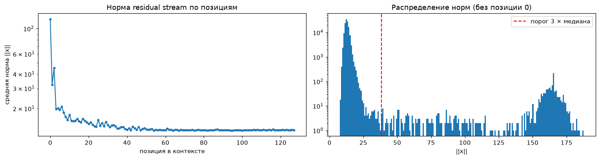

У некоторых токенов длина вектора **в ~10 раз больше** обычной: у самой первой позиции текста всегда, а дальше
у переводов строки `\n` и точек `.`. Это известный эффект **massive activations** (Sun et al., 2024). Модель
использует такие токены как **attention sink** («сток внимания»): когда «голове внимания» не на что смотреть,
она смотрит туда.

| | значение |
|---|---|
| доля токенов-выбросов | **0.93 %** |
| их доля во всей дисперсии данных | **64 %** |

Меньше 1 % токенов «весит» почти две трети! Их легко восстановить (они все похожи), поэтому с ними метрика качества
получилась бы завышенной у **любой** модели: ошибки на нормальных токенах утонули бы в огромной дисперсии выбросов.

> **Аналогия.** В классе 100 учеников, у одного 1 000 000 рублей, у остальных по 100. «Средний доход класса»
> 10 000 рублей ничего не говорит про обычного ученика. Прежде чем что-то считать, миллионера нужно убрать.

Поэтому позицию 0 и токены с нормой больше 3 медиан **исключили** из обучения и оценки. Так обычно и делают
при обучении SAE.

Итоговые данные: 64 000 токенов на обучение (1000 шагов × 64, каждый токен используется один раз) и 20 000
отложенных токенов для честной проверки.

### 4.3 Метрики

**Explained Variance (EV, объяснённая дисперсия):**

$$
\mathrm{EV} = 1 - \frac{\mathrm{Var}(x - \hat x)}{\mathrm{Var}(x)}
$$

Словами: какая доля «разнообразия» данных воспроизведена. EV = 1 — идеально, EV = 0 — не лучше, чем выдавать
средний вектор.

> **Аналогия.** Вы пересказываете фильм. EV = 0.8 значит «пересказ передал 80 % сюжета».

Считали двумя способами (методичка разрешает оба):
- **вдоль размерности признаков** (основной, как в тексте методички): для каждого токена дисперсия по его 512
  числам, потом среднее по токенам;
- **по батчу**: для каждой из 512 координат дисперсия по токенам, потом суммирование. Этот вариант строже.

**Dead Latents Ratio (доля мёртвых латентов):** сколько из 2048 латентов **ни разу** не сработали за последние
500 шагов (32 000 токенов).

> **Аналогия.** Краски в палитре, которые ни разу не открывали. Купили 2048 красок, а используете 1400:
> треть денег выброшена.

### 4.4 Сломанный SAE

Обучили `BrokenTopKSAE` из методички (1000 шагов, батч 64, Adam):

| Метрика | BrokenTopKSAE |
|---|---|
| EV (последние 500 шагов) | 0.77 |
| EV на отложенных данных | 0.78 |
| EV по батчу на отложенных | 0.67 |
| **Мёртвые латенты** | **33 %** (≈ 680 из 2048) |

Треть словаря мертва. По EV поломка видна хуже, потому что EV — «снисходительная» метрика: и оставшихся
1400 латентов хватает, чтобы грубо восстановить вход.

### 4.5 Три ошибки и их исправление

#### Ошибка 1. Нет ReLU после Top-K и нет центрирования входа

`topk` выбирает 32 **наибольших** числа, но они могут быть **отрицательными** (особенно в начале обучения,
когда все числа около нуля). Тогда латент «вычитает» своё направление, и признак теряет смысл: понятие
«открывающая скобка» либо есть, либо его нет, «минус скобки» не бывает.

Кроме того, энкодер получает $x$ без вычитания $b_{dec}$. У residual stream большое **среднее** (общая часть, как
«ветер» из задания 1), поэтому одни и те же латенты выигрывают Top-K почти на каждом токене, реагируя на общую
часть, а не на содержание.

**Исправление:** $\text{pre} = (x - b_{dec}) W_{enc} + b_{enc}$, затем Top-K, затем ReLU. А $b_{dec}$ стартует
со **среднего вектора данных**.

> **Аналогия.** Чтобы понять, чем конкретный человек отличается от других, сначала вычитаем «среднего человека».
> Иначе все описания начинаются с «две руки, две ноги», и важное теряется.

#### Ошибка 2. Неправильная инициализация и масштаб декодера

$W_{enc}$ и $W_{dec}$ инициализированы **независимо** и очень мелко (0.02). Энкодер и декодер «не знают друг
о друге»: латент, выбранный энкодером, восстанавливает случайное направление. Градиент получают несколько
«везучих» латентов, а остальные навсегда проигрывают Top-K и умирают. Кроме того, длина строк декодера ничем
не ограничена, поэтому «сила признака» теряет смысл: модель может перекачивать масштаб между энкодером и декодером.

**Исправление** (как в статье OpenAI, Gao et al., 2024):
- строки $W_{dec}$ — направления **единичной** длины;
- $W_{enc} = W_{dec}^T$ при старте: каждый латент сразу «узнаёт» своё собственное направление;
- после каждого шага строки $W_{dec}$ снова нормируются на 1.

> **Аналогия.** Энкодер — тот, кто **узнаёт** цвет, декодер — тот, кто его **смешивает**. Если у них разные,
> случайные каталоги красок, узнанная «краска №7» у второго окажется совсем другим цветом. Правильно выдать обоим
> один каталог с самого начала.

#### Ошибка 3. Нет механизма «оживления» мёртвых латентов

В Top-K SAE латент, который не попал в топ-32, **не получает градиента вообще**. Раз «умерев», он не может
вернуться: его никто не учит.

**Исправление: AuxK loss** (вспомогательная функция потерь из статьи OpenAI). Мёртвые латенты (не срабатывавшие
последние 50 шагов) дополнительно учатся объяснять **остаток**, то есть то, что основная модель не смогла
восстановить. Так они получают градиент, постепенно становятся полезными и возвращаются в игру. Параметры взяты
из статьи: $k_{aux} = 256$, коэффициент $1/32$.

> **Аналогия.** Запасных игроков, которые никогда не выходят на поле, отправляют тренироваться на «недоработках»
> основного состава. Со временем они становятся достаточно хороши, чтобы попасть в основу.

#### Прочие настройки

Adam с lr = 3e-3, betas = (0.9, 0.99), короткий «разогрев» (первые 50 шагов lr плавно растёт) и косинусное
затухание к концу. Одинаковые настройки использованы для сломанной и исправленной моделей, чтобы сравнение было честным.

### 4.6 Результат

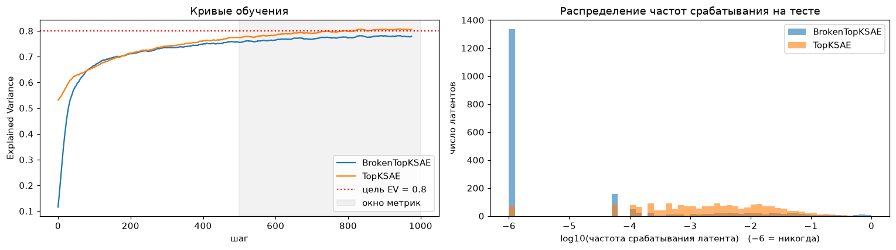

| | BrokenTopKSAE | TopKSAE | требование |
|---|---|---|---|
| EV на отложенных токенах | 0.78 | **0.81** | ≥ 0.80 ✓ |
| EV (последние 500 шагов) | 0.77 | 0.79 | |
| EV по батчу на отложенных | 0.67 | 0.71 | |
| **Мёртвые латенты** | **33 %** | **0.4 %** (8 из 2048) | ≤ 5 % ✓ |
| Время обучения | ~14 с | ~22 с | |

На правом графике видно «кладбище»: у сломанной модели ~1300 латентов с частотой «никогда» (столбик слева),
у исправленной их почти нет, и частоты распределены равномерно. Почему здесь 1300, а в таблице 680: гистограмма
строится по **финальной** модели на отложенных токенах, а 680 — это латенты, не сработавшие ни разу за 500
шагов обучения, когда модель ещё менялась. К концу обучения сломанный SAE «схлопывается» ещё сильнее.

**Про порог EV ≥ 80 %.** На отложенных данных — 0.81 ✓. Среднее за последние 500 шагов чуть ниже (0.79),
потому что в это окно входит модель на шагах 500–700, которая ещё доучивается. Качество упирается в количество
данных: 64 000 токенов, каждый виден один раз. В пробных запусках при 3000 шагах EV доходил до 0.82–0.83.

### 4.7 Абляция: какое исправление что даёт

**Абляция** — исследование, где исправления добавляются по одному и смотрится вклад каждого.

| Шаг | EV на тесте | Мёртвые |
|---|---|---|
| 0. как в Broken | 0.78 | 33 % |
| 1. + ReLU и центрирование | 0.81 | 12 % |
| 2. + единичный декодер, $W_{enc} = W_{dec}^T$ | 0.81 | 2.8 % |
| 3. + AuxK | 0.81 | **0.4 %** |

- Исправление 1 даёт основной рост качества и убирает почти две трети мёртвых.
- Исправление 2 почти добивает мёртвых. EV при этом чуть снижается (на 0.006) — это цена ограничения
  «длина направления = 1». Зато активация теперь означает понятную «силу признака», что нужно для задания 4.
- Исправление 3 оживляет оставшихся.

> **Коротко о задании 3.** Все три ошибки найдены и исправлены. Мёртвых латентов стало меньше с 33 % до 0.4 %,
> EV на тесте 0.81. Попутно обнаружена ловушка данных: 1 % токенов-«крикунов» несёт 64 % дисперсии.

---

## 5. Задание 4. Steering: рулим моделью через нейрон и через признак

### Зачем это задание

Проверить на практике, что направления SAE **осмысленные** (моносемантичные), а отдельные нейроны — нет.
Для этого мы **вмешиваемся** в работу модели: добавляем вектор в residual stream и смотрим, как меняется
сгенерированный текст.

**Steering** (руление) — добавление вектора в «тетрадь» модели во время работы:

$$
x_{steered} = x + \alpha \cdot v
$$

где $v$ — направление (единичной длины), а $\alpha$ — сила воздействия.

> **Аналогия.** Экспертам, которые передают тетрадь, мы подсовываем записку «думай о скобках» ($v$) с
> громкостью $\alpha$. Вопрос: изменится ли тема текста, или эксперты просто собьются?

Сравниваем два вида записок:
- **Neuron steering:** $v = e_i$ — «повернуть одну ручку» (одну координату из 512), например 42-ю;
- **Feature steering:** $v = v_{SAE}$ — направление признака из словаря SAE.

### 5.1 Калибровка силы воздействия

Нельзя брать произвольное $\alpha = 50$: неясно, много это или мало. Поэтому измерили **типичную длину** вектора
residual stream на нейтральных текстах:

| | $\mathbb{E}\|x\|$ |
|---|---|
| все токены, кроме первого | 31.4 |
| **без выбросов (attention sink)** | **R = 13.4** |

Выбросы снова исключены (иначе шкала завысилась бы в 2.3 раза). Сила измеряется в долях $R$: $\alpha$ от $0.1R$ до $1.5R$.

> **Аналогия.** Громкость подсказки измеряем относительно обычной громкости разговора в комнате, а не в абсолютных децибелах.

### 5.2 Хук (hook) — как вмешаться в работу модели

Если подменить вектор один раз до генерации, изменится только первый шаг: модель генерирует текст **в цикле**
и каждый раз пересчитывает всё заново. Поэтому используется **forward hook** — функция, которую PyTorch
автоматически вызывает **каждый раз**, когда 3-й блок заканчивает работу. Она прибавляет $\alpha v$ к его выходу.

> **Аналогия.** Хук — это «жучок» на конвейере после 3-го станка. Каждая деталь, которая с него сходит,
> автоматически получает наклейку. Неважно, сколько деталей и в каком порядке.

**Про размерности и KV-кэш.** При генерации модель сначала обрабатывает весь промпт: форма тензора
`[1, 12, 512]` (1 текст, 12 токенов, 512 чисел). Дальше она **запоминает** уже посчитанное (это и есть
**KV-кэш**, «шпаргалка» с прошлых шагов) и обрабатывает только один новый токен: форма `[1, 1, 512]`.
Наш вектор $v$ формы `[512]` автоматически прибавляется к каждой позиции в обоих случаях — это **бродкастинг**
(PyTorch сам «размножает» вектор на нужное число позиций). Проверено в ноутбуке: хук увидел формы
`(1, 12, 512), (1, 1, 512), (1, 1, 512), …`

**Про способ генерации.** Жадная генерация (всегда брать самое вероятное слово) у маленькой Pythia зацикливается
даже без вмешательства («a large table with a large table with…»). Тогда не отличить «бред из-за стиринга» от
обычного повтора. Поэтому использовано **сэмплирование** (случайный выбор из 40 самых вероятных слов) с
**фиксированным seed**: при каждом $\alpha$ «случайность» одинаковая, и результаты сравнимы.

### 5.3 Эксперимент А: нейрон $e_{42}$

Промпт: *"In the middle of the room there was a large table with"*

| $\alpha$ | Продолжение |
|---|---|
| 0 | *a large counter and a table with a large counter. When the front door appeared…* |
| 0.25R | *a large iron door and a small table with a large iron lid…* |
| 0.5R | *a large iron door and a small pocket, which was a small table in the corner…* |
| 0.75R | *a large sitting stone and a paper pocket, which was placed on top of the dike…* |
| 1.0R | *door-door door-door door-door door-door…* |
| 1.5R | *gated on which he he was held, I In (переводы строк)* |

**Анализ.** До $0.75R$ текст остаётся про ту же комнату, меняются только случайные детали («iron», «pocket»).
**Интерпретируемой новой темы нет.** При $R$ начинается дегенерация (повторы), при $1.5R$ — обрывки.
Это **не** полисемантичное «прыгание между темами», а **потеря синтаксиса**: нейрон 42 не соответствует
никакому понятию модели, и толчок вдоль него — просто шум.

### 5.4 Эксперимент Б: поиск моносемантического латента

**Что делали.** Составили 30 предложений: 12 со скобками (код и научный текст), 5 с кавычками (прямая речь)
и 13 нейтральных. Прогнали через модель и SAE и для каждого латента посчитали:
1. среднюю активацию на **целевых** токенах (скобках);
2. долю целевых токенов, где латент активен;
3. долю **остальных** токенов, где латент активен. По условию методички она должна быть ≤ 1 %.

Среди латентов, прошедших условие 3, выбрали самый сильный по условию 1.

*Формула из методички* $f(x) = \mathrm{ReLU}(W_{enc}(x - b_{dec}) + b_{enc})$ относится к обычному ReLU-SAE.
У нашего Top-K SAE после неё оставляются только 32 самых сильных латента. Используются именно эти активации:
на них SAE обучался.

| латент | средняя активация на «(» | активен на «(» | активен на остальных |
|---|---|---|---|
| **1610** | **1.94** | **100 %** | **0.8 %** |
| 48 | 0.32 | 36 % | 0.4 % |
| 1185 | 0.23 | 36 % | 0.8 % |

Для кавычек аналогично нашёлся латент **813** (100 % кавычек, 0.7 % остальных).

**Проверка моносемантичности на большом корпусе.** Методичка предупреждает: латент, выбранный по одному
предложению, может оказаться «пунктуацией вообще». Поэтому проверили топ-активации латента 1610 на 130 тысячах
токенов The Pile:

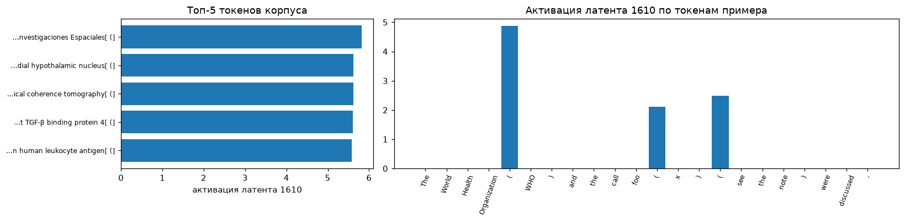

| активация | контекст → токен |
|---|---|
| 5.82 | *…Instituto Nacional de Investigaciones Espaciales* → **(** |
| 5.62 | *…dorsomedial hypothalamic nucleus* → **(** |
| 5.61 | *…optical coherence tomography* → **(** |
| 5.61 | *…latent TGF-β binding protein 4* → **(** |
| 5.58 | *…human leukocyte antigen* → **(** |

Все топ-примеры — **скобка после длинного термина**, то есть скобка, за которой обычно идёт **аббревиатура**
(«Instituto Nacional de Investigaciones Espaciales (INPE)»). На примере справа латент сильнее всего
срабатывает на «Organization **(** WHO)» (≈ 4.9) и слабее на скобках в коде (≈ 2). Латент срабатывает на 1.2 %
токенов корпуса. Это узкое, понятное понятие — **моносемантичный** признак.

### 5.5 Эксперимент В: стиринг по признаку SAE

$v_{SAE}$ — строка 1610 декодера, нормированная на длину 1. (В нашем коде $W_{dec}$ имеет форму `[2048, 512]`,
поэтому направление — это **строка**. В методичке матрица записана транспонированной, там это столбец.)

| $\alpha$ | Продолжение |
|---|---|
| 0 | *a large counter and a table with a large counter…* |
| 0.25R | *a large glass door and a small folding door. The light-on began shining…* |
| 0.5R | *out-and-upholeholesbholeholeholeholes…* |
| 0.75R | *outoveror2x2x2x2x2x2x…* |
| 1.0R | *a5sd22k2k2k2k2k…* |

При $0.5R$ и выше появляются **буквенно-цифровые коды и сокращения**: «2x2x», «5sd22k». Именно это модель ожидает
увидеть **после** скобки, открывающей аббревиатуру! Модель «думает», что только что прочитала «(» перед
сокращением, и продолжает соответственно. Концепт внесён — прямое подтверждение того, что латент моносемантичен.

### 5.6 Отчёт 1: сравнительная таблица

| Вмешательство | $\alpha$ | Текст |
|---|---|---|
| базовая модель | 0 | *a large counter and a table with a large counter. When the front door appeared…* |
| нейрон $e_{42}$ | слабое, 0.25R = 3.4 | *a large iron door and a small table with a large iron lid…* |
| нейрон $e_{42}$ | среднее, 0.5R = 6.7 | *a large iron door and a small pocket, which was a small table in the corner…* |
| нейрон $e_{42}$ | сильное, 1.0R = 13.4 | *door-door door-door door-door…* |
| SAE-латент 1610 | слабое, 0.25R | *a large glass door and a small folding door. The light-on began shining…* |
| SAE-латент 1610 | среднее, 0.5R | *out-and-upholeholesbholeholeholes…* |
| SAE-латент 1610 | сильное, 1.0R | *a5sd22k2k2k2k2k…* |

**Как меняется семантика:**
- **нейрон:** тема та же (комната, стол, дверь), детали случайно «плывут», при большой силе — повторы. Нового смысла нет;
- **SAE:** при малой силе текст связный; при средней и сильной появляется узнаваемое понятие (аббревиатуры и коды,
  как после «(»), но быстро теряется грамматика.

### 5.7 Отчёт 2: количественный анализ (loss и концепт)

**Что измеряли:**
1. **Cross-Entropy (CE)** на нейтральном корпусе: 48 кусков текста по 64 токена из The Pile, которые не
   использовались при обучении SAE. Чем выше CE, тем хуже модель предсказывает нормальный текст, то есть тем
   сильнее она «сломана». (Перплексия — это $e^{CE}$, «среди скольких слов модель в среднем колеблется».)
2. **Вероятность аббревиатуры**: сколько вероятности модель отдаёт токенам вида `WHO`, `DNA`, `UK` (2 и больше
   заглавные буквы или цифры). Это мера того, **вносится ли концепт**.

Для контроля добавлены ещё три направления той же длины: нейрон $e_{128}$, **случайное** направление и нейрон
$e_{156}$ (о нём ниже).

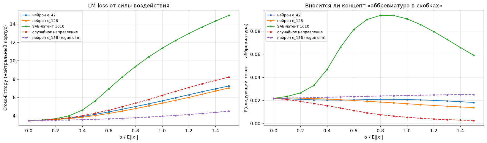

| $\alpha / R$ | 0 | 0.3 | 0.5 | 1.0 | 1.5 |
|---|---|---|---|---|---|
| CE, нейрон $e_{42}$ | 3.50 | 3.74 | 4.16 | 5.63 | 7.24 |
| CE, нейрон $e_{128}$ | 3.50 | 3.70 | 4.03 | 5.38 | 7.03 |
| CE, **SAE-латент 1610** | 3.50 | 4.00 | 5.65 | **11.36** | 14.93 |
| CE, случайное направление | 3.50 | 3.79 | 4.29 | 6.22 | 8.21 |
| CE, нейрон $e_{156}$ (rogue dim) | 3.50 | 3.54 | 3.62 | 3.95 | 4.52 |

#### Результат, который **не совпал** с ожиданием методички

Методичка просит объяснить, почему SAE-вектор при одинаковой норме **дольше** сохраняет связность. В нашем
эксперименте получилось **наоборот**: SAE-вектор поднимает loss **сильнее** нейрона и даже случайного направления
(при $\alpha = R$: 11.4 против 5.6).

**Объяснение: «чувствительные» направления.** SAE по построению находит направления, которые модель **реально
использует**, то есть те, которые следующие слои «читают». Толчок вдоль такого направления сильно меняет
вычисления: так и должен работать настоящий признак. Базисные нейроны и случайные направления в основном
попадают туда, к чему последующие слои **малочувствительны**, и их эффект «размазывается».

> **Аналогия: пульт звукорежиссёра.** На пульте 512 ручек. Большинство подключены слабо или «вперемешку»
> (базисные нейроны), и если крутануть одну, звук чуть «поплывёт». А ручка SAE-признака — это, например,
> «громкость барабанов»: она подключена напрямую. Если выкрутить её на максимум, барабаны заглушат всё.
> Эффект сильнее именно **потому**, что ручка осмысленная.

**Крайний случай — нейрон $e_{156}$ («rogue dimension», «измерение-изгой»).** В этом измерении у residual stream
огромное **постоянное** значение, почти одинаковое у всех токенов. Модель привыкла его игнорировать (оно работает
как константа), поэтому толчок вдоль него почти ничего не меняет: CE растёт едва заметно.

#### Но концепт вносит только SAE-вектор

Правый график показывает главное:
- **SAE-латент 1610:** вероятность аббревиатуры растёт с 2.2 % до ≈ 6.6 % при $0.5R$ и до ≈ 9 % при $0.8R$ (в 4 раза);
- **нейроны и случайное направление:** не растёт вообще (у случайного даже падает).

При $\alpha \approx 0.3R$ SAE-вектор уже повышает долю аббревиатур в 1.5 раза, а loss вырастает лишь на 0.5.
Нейрон этот концепт **не вносит ни при какой силе**, только портит текст.

**Как понимать тезис методички.** Сравнивать нужно при **одинаковом полезном эффекте**, а не при одинаковой
длине добавленного вектора. При равном эффекте («добавить концепт аббревиатур») SAE выигрывает однозначно:
нейрон такого эффекта не даёт вообще.

> **Аналогия.** Хотите посолить суп. Ложка соли (SAE-вектор) — это именно то, что нужно, но две ложки
> испортят суп сильнее, чем две ложки воды (нейрон). Вода «безопаснее», но она **вообще не солит**.

### 5.8 Отчёт 3: фазовый переход в бред

**Как измеряли связность.** Для 5 нейтральных промптов × 2 seed сгенерировали по 25 токенов и посчитали
**distinct-2** — долю **уникальных пар соседних слов**. У нормального текста она около 0.95 (пары почти не
повторяются), у зацикленного «2x2x2x» падает до 0.3–0.5. Порог перехода в бред — первое $\alpha$, где distinct-2 < 0.8.

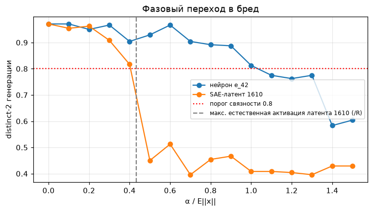

| | порог перехода в бред |
|---|---|
| SAE-латент 1610 | $\alpha^* \approx 0.5R \approx 6.7$ — **резкий** обвал |
| нейрон $e_{42}$ | $\approx 1.1R \approx 14.8$ — плавное ухудшение |

У SAE distinct-2 держится ≈ 0.9 до $0.3R$, при $0.4R$ равен 0.82, а при $0.5R$ падает сразу до 0.45.
Это настоящий **фазовый переход**: не постепенное ухудшение, а скачок.

#### Почему порог именно здесь: главная находка задания

**Порог совпадает с «естественным масштабом» признака.** Максимальная активация латента 1610 во всём корпусе
равна 5.8 ≈ $0.43R$ (серая пунктирная линия на графике). Порог перехода — между $0.4R$ и $0.5R$.

- Пока $\alpha$ в пределах естественных значений, вектор $x + \alpha v$ выглядит для модели как «токен, где очень
  уверенно выражена открывающая скобка». Такое модель видела при обучении, это **на многообразии данных**,
  и она обрабатывает его осмысленно.
- Когда $\alpha$ превышает всё, что модель когда-либо видела, вектор уходит **за пределы распределения**
  (off-distribution). Модель в такой ситуации не обучалась, и её поведение становится бессмысленным.

> **Аналогия.** Человек привык, что громкость голоса собеседника от шёпота до крика. Пока вы говорите в этих
> пределах, он понимает. Если включить сирену в 150 децибел, он не «лучше поймёт», а просто перестанет что-либо
> понимать.

**Геометрия.** Следующие слои получают $x$ после **LayerNorm** (нормировки длины), то есть по сути видят только
его **направление**. Если $v$ перпендикулярен $x$, то доля направления $v$ в сумме:

$$
\cos(x + \alpha v,\ v) = \frac{\alpha}{\sqrt{R^2 + \alpha^2}}
$$

- при $\alpha = 0.5R$: ≈ 0.45;
- при $\alpha = R$: ≈ 0.71.

После порога **собственное содержимое токена** становится меньшей частью направления. На **каждой** позиции модель
видит почти одно и то же состояние «после скобки». Предсказание перестаёт зависеть от контекста, и генерация
зацикливается («2k2k2k»). Даже сам концепт разрушается: вероятность аббревиатур достигает пика около $0.8R$
и затем падает. Модель уже не в состоянии «достроить» осмысленное сокращение.

> **Аналогия.** Если в каждую фразу разговора вставлять одно и то же громкое слово, скоро разговор будет
> состоять только из этого слова, и собеседники начнут просто повторять его.

---

## 6. Где результаты разошлись с методичкой (важно для защиты)

Все расхождения — **честные результаты** эксперимента, а не ошибки. В ноутбуке каждое проверено и объяснено.

| Место | Методичка ожидает | Получилось | Почему |
|---|---|---|---|
| 1.2 | у `embed_in` средний косинус 0.15–0.35 | 0.003 | у Pythia входные и выходные эмбеддинги **раздельные**; конус есть у `embed_out` (0.92), показан на нём |
| 2.3 | есть точка коллапса $p^*$ (NMSE ≥ 0.95) | при $b = 0$: $p^* \le 0.01$; при оптимальном $b$: коллапса нет даже при $p = 1$ | порог, подобранный под каждое $p$, позволяет деградировать плавно |
| 2.4 | антиподальные пары | почти нет, вместо них «многогранник» с отрицательными косинусами ≈ −0.5 | нужно упаковать 4 признака на измерение, пары для этого невыгодны |
| 3 | сломанный SAE: EV 50–60 %, мёртвых > 40 % | EV 77 %, мёртвых 33 % | зависит от lr и данных; при lr = 1e-4 в пробном запуске было 51 % и 85 % |
| 3 | EV ≥ 80 % | 0.81 на тесте, 0.79 в окне обучения | в окно входит недоучившаяся модель; мало данных (64 000 токенов) |
| 4.2 | SAE-вектор дольше сохраняет связность | при равной норме ломает **быстрее** | SAE-направления «чувствительные»; но концепт вносит **только** SAE |

---

## 7. Вероятные вопросы на защите и короткие ответы

**— Что такое концентрация меры?**
В многомерном пространстве случайные векторы почти всегда почти перпендикулярны: их косинус сосредоточен около нуля с разбросом $1/\sqrt d$.

**— Почему у эмбеддингов LLM средний косинус положительный?**
Градиент softmax толкает все «неправильные» слова против среднего контекста, то есть в одну сторону. Накапливается общая компонента, и все векторы попадают в узкий конус. К тому же у выходного слоя нет смещения, и общее направление служит «осью частотности» слов.

**— Как это исправить?**
Центрирование (вычесть средний вектор) убирает сдвиг, whitening выравнивает форму облака. После whitening распределение косинусов совпадает с $\mathcal{N}(0, 1/d)$.

**— Что такое суперпозиция?**
Хранение большего числа признаков, чем измерений. Возможно, потому что признаки редко активны одновременно, и помехи между ними появляются редко.

**— Зачем порог $b$ и почему при $b = 0$ ошибка больше 1?**
ReLU пропускает положительное эхо от других признаков: без порога у ~половины неактивных признаков появляются ложные срабатывания. Ошибка ≈ $(M-1)/(2d) = 1.95$, и это не зависит от $p$.

**— Почему нужен NMSE, а не MSE?**
MSE растёт просто потому, что с ростом $p$ растёт энергия входа. NMSE делит ошибку на энергию входа, и сравнение становится честным. Нулевая модель имеет NMSE = 1.

**— Какую геометрию выучила обученная модель?**
Избегает положительных косинусов (они вредят через ReLU) и прячет помехи в отрицательные (их ReLU срезает). Средний косинус $\approx -1/(M-1)$.

**— Что такое SAE и зачем он нужен?**
Автоэнкодер, который раскладывает вектор модели на небольшое число (32 из 2048) осмысленных направлений-признаков. Нужен, чтобы «размешать» суперпозицию и получить моносемантичные признаки.

**— Какие три ошибки были в SAE?**
1) Нет ReLU после Top-K и нет центрирования на $b_{dec}$. 2) Независимая мелкая инициализация и ненормированный декодер. 3) Нет AuxK loss для оживления мёртвых латентов.

**— Почему латенты умирают?**
Латент, не попавший в Top-K, не получает градиента. Если он проиграл в начале, его никто не учит, и он не может вернуться. AuxK даёт таким латентам градиент на задаче «объяснить остаток».

**— Что такое massive activations и почему их убрали?**
У первого токена и некоторых `\n` и `.` норма вектора в ~10 раз больше (attention sink). 0.93 % таких токенов несут 64 % дисперсии и завышают EV у любой модели.

**— Зачем forward hook при генерации?**
Генерация идёт в цикле, и модель каждый раз пересчитывает residual stream. Хук вызывается на каждом прогоне и добавляет вектор всегда. Благодаря бродкастингу он работает и для `[1, seq, 512]`, и для `[1, 1, 512]` (KV-кэш).

**— Почему SAE-вектор ломает текст сильнее нейрона?**
Он направлен туда, куда модель действительно «смотрит» (чувствительное направление). Зато только он вносит концепт: вероятность аббревиатур растёт в 4 раза, а нейрон её не меняет.

**— При каком $\alpha$ начинается бред и почему?**
Около $0.5R \approx 6.7$. Это совпадает с максимальной естественной активацией признака (5.8). Дальше вектор выходит за пределы того, что модель видела при обучении, после LayerNorm направление $v$ начинает преобладать над содержимым токена, и генерация зацикливается.

---

## 8. Словарик терминов

| Термин | Простыми словами |
|---|---|
| **AuxK loss** | Дополнительное обучение для «мёртвых» латентов: они учатся объяснять остаток ошибки и оживают |
| **Adam** | Популярный алгоритм обучения, сам подбирающий шаг для каждого параметра |
| **Attention sink** | Токен, на который «головы внимания» смотрят, когда им не на что смотреть; у него огромная норма |
| **Baseline** | Простейшая модель для сравнения (у нас — «всегда отвечать нулём») |
| **Батч (batch)** | Порция примеров, обрабатываемых за один шаг обучения |
| **Бродкастинг** | Автоматическое «размножение» маленького массива, чтобы сложить его с большим |
| **Вектор** | Список чисел, «стрелка» в многомерном пространстве |
| **Градиент** | Направление, в котором loss растёт быстрее всего; идём в обратную сторону |
| **Декодер / энкодер** | Части автоэнкодера: энкодер «сжимает/кодирует», декодер «восстанавливает» |
| **Дисперсия** | Мера разброса значений вокруг среднего |
| **distinct-2** | Доля уникальных пар соседних токенов; низкая означает, что текст зациклился |
| **Explained Variance (EV)** | Какая доля разнообразия данных восстановлена моделью |
| **Эксцесс** | Мера «тяжести хвостов» распределения; 0 — как у нормального |
| **Эмбеддинг** | Вектор, представляющий токен |
| **Forward hook** | Функция, автоматически вызываемая после работы слоя; через неё можно изменить выход |
| **Интерференция** | «Эхо» от других признаков из-за того, что их направления не перпендикулярны |
| **KV-кэш** | «Шпаргалка» модели при генерации, чтобы не пересчитывать старые токены |
| **Косинус** | Насколько два вектора смотрят в одну сторону (от −1 до 1) |
| **Латент** | Один элемент кода SAE; в идеале одно понятие |
| **LayerNorm** | Нормировка вектора внутри слоя модели (делает длину стандартной) |
| **Learning rate** | Размер шага обучения |
| **Loss** | Число, показывающее, насколько модель ошибается |
| **Massive activations** | Редкие токены с аномально большой нормой вектора |
| **Матрица Грама** | Таблица косинусов между всеми парами направлений |
| **Моносемантичный** | Отвечающий за одно понятие |
| **Норма** | Длина вектора |
| **Нормальное распределение** | «Колокол»; $\mathcal{N}(\mu, \sigma^2)$ |
| **NMSE** | Ошибка, делённая на энергию сигнала; 1 = как у нулевой модели |
| **Полисемантичный** | Отвечающий за смесь несвязанных понятий |
| **ReLU** | $\max(0, z)$: пропускает положительное, обнуляет отрицательное |
| **Residual stream** | «Общая тетрадь» токена, в которую каждый слой дописывает свою поправку |
| **Rogue dimension** | Измерение с огромным постоянным значением, которое модель в основном игнорирует |
| **SAE (Sparse Autoencoder)** | Автоэнкодер с разреженным кодом, раскладывающий активации на понятия |
| **Seed** | «Зерно» генератора случайных чисел; одинаковое зерно даёт одинаковую «случайность» |
| **Softmax** | Превращает оценки слов в вероятности (сумма 1) |
| **Steering** | Управление моделью добавлением вектора в её активации |
| **Суперпозиция** | Хранение признаков, число которых больше числа измерений |
| **Токен** | Кусочек текста (слово, часть слова, знак) |
| **Top-K** | Оставить K наибольших значений, остальные обнулить |
| **Whitening** | Преобразование, делающее разброс данных одинаковым во всех направлениях |
| **Центрирование** | Вычитание среднего вектора |
| **Cross-Entropy (CE)** | Loss предсказания слова; чем меньше, тем лучше модель предсказывает текст |
